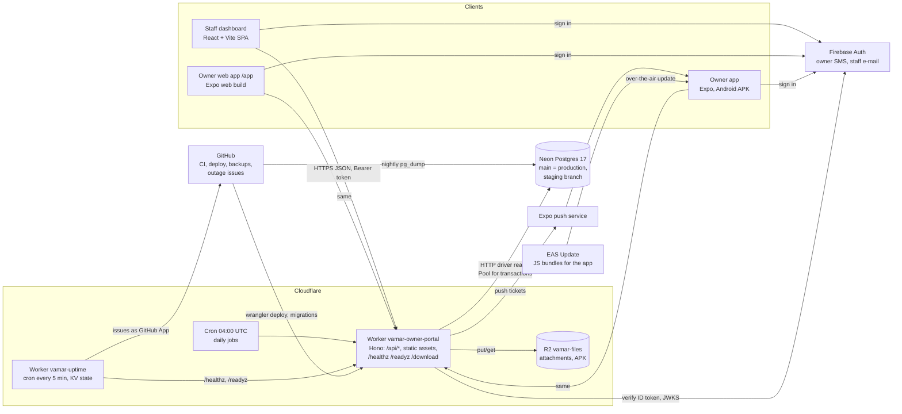

# Architecture

One Cloudflare Worker serves the JSON API, the staff dashboard and the owner web app; one Neon
Postgres database holds everything; the owner app is an Expo app on Android and a web app on
iPhone. Business rules live once, in `packages/shared`, and run unchanged on the Worker, in the
browser and on the phone. Details and decisions: PROJECT.md. Operations: HANDOVER.md. Costs and
limits: HANDOVER.md "Running costs".

## Request flow

1. A client calls `/api/...` with `Authorization: Bearer <access token>` (15 min JWT signed by the
   Worker, `apps/api/src/auth/tokens.ts`). Non-API paths are the dashboard's static assets; `/app/*`
   is the owner web app; `run_worker_first` in `apps/api/wrangler.jsonc` lists what the Worker
   answers itself.
2. `app.ts` adds the request id, secure headers, body limits and one JSON log line; `auth/middleware.ts`
   checks the token and the session row (cached 60 s per isolate, `auth/session-cache.ts`).
3. Routes (`routes/*.ts`, staff under `routes/staff/`) validate input with the zod schemas from
   `@vamar/shared` and call a service (`services/*.ts`). Services hold the queries (Drizzle,
   `@vamar/db`) and use the shared rules for money, dates, allocation and state machines. Owner
   queries are always scoped through `services/owner-scope.ts`.
4. Reads use the Neon HTTP driver; multi-statement writes open a per-request `Pool` closed with
   `waitUntil`. Every change writes `audit_log`.

## Auth

- Owners: phone number and SMS code with Firebase (native SDK on Android, JS SDK on the web), then
  `POST /api/auth/owner/*` exchanges the Firebase ID token for our access token plus a 30-day
  refresh token bound to the device. The phone must match `ALLOWED_PHONE_COUNTRIES`.
- Staff: e-mail and password with Firebase, then an authenticator code (TOTP, secret encrypted with
  `TOTP_ENC_KEY`), then a 12-hour session; roles `admin`, `editor`, `viewer`.
- Refresh tokens rotate; a replayed one ends the chain. Revoking a session reaches every isolate
  within the 60 s session cache.

## Data model

28 tables in `packages/db/src/schema/` (Drizzle, SQL migrations in `packages/db/migrations`):
people (`owners`, `staff_users`, `devices`, `sessions`), property (`buildings`, `units`,
`unit_ownerships` with from/to dates, `unit_status_events`), leases (`tenants`, `contracts`,
`cheques`, `cheque_events`), cases (`disputes`, `dispute_cheques`, `dispute_updates`), money out
(`expenses`, `expense_allocations`, `expense_categories`, `vendors`, `recurring_expense_rules`,
`budgets`), work (`work_orders`, `repair_approvals`), messages (`message_threads`,
`thread_messages`), and system tables (`attachments`, `calendar_events`, `holidays`,
`app_settings`, `notification_log`, `audit_log`, `rate_limits`, `imports`, `dispute_counters`).
Money is bigint fils, business dates are `date` columns read as `YYYY-MM-DD` strings in Dubai,
ids are UUID v7 made in code. `audit_log` and `cheque_events` are append-only for the runtime role.

## Background jobs, push, files

- **Daily job** (`apps/api/src/cron.ts`, cron `0 4 * * *` on production only): cheque and contract
  alerts, expiring contracts, retention purge, recurring expense drafts, hearing reminders, the
  monthly owner summary (1st to 3rd), silent repair approvals. Each step is isolated; each push
  has a dedupe key in `notification_log`. Staging runs it with `POST /api/staff/jobs/daily`.
- **Push**: Expo push tokens on `devices`; the Worker posts batches of 100 to the Expo push
  service (`services/notifications.ts`) through `util/outbound.ts` (deadline, retries). The app
  maps each notification type to a screen (`apps/mobile/src/lib/push-routes.ts`).
- **Files**: uploads go through the Worker to R2 (`services/attachments.ts`), metadata in
  `attachments`; downloads are authorised per owner or staff and streamed back. The Android APK
  is in the same bucket under `releases/`.

## Monitoring, backups

`monitor/` is a separate Worker that checks `/healthz` every 5 minutes and `/readyz` every 2 h
(production) or 12 h (staging) and opens a GitHub issue when a target is down; `uptime.yml` is its
backup and watcher. Logs: Workers observability and `wrangler tail` (one line per request,
request id). Errors go to Sentry once `SENTRY_DSN` is set. `backup.yml` dumps production nightly,
encrypts it with age and keeps it as a workflow artifact (35 days) and, with a key, in R2.

## Environments and deploy

| Environment | API and dashboard                      | Database                                                       |
| ----------- | -------------------------------------- | -------------------------------------------------------------- |
| Local       | `pnpm dev` (wrangler dev or tsx, Vite) | Docker Postgres 17 on 5433, Firebase emulator                  |
| Tests       | Vitest in process                      | PGlite in process (no server), Playwright: CI service Postgres |
| Staging     | Worker `vamar-owner-portal-staging`    | Neon staging branch, bucket `vamar-files-staging`              |
| Production  | Worker `vamar-owner-portal`            | Neon `main`, bucket `vamar-files`                              |

Push to any branch runs `ci.yml` (typecheck, lint, format, unit and integration tests with
coverage floors, monitor tests, bundle budget, Worker dry run, app bundle, gitleaks and audit,
Playwright with axe and a load smoke, Docker stack). A green CI on `main` triggers `deploy.yml`:
migrate the staging branch, build, deploy staging, smoke and Playwright against it. A `v*` tag
does the same and then production. The owner app's JavaScript ships with `eas update`; native
changes need an EAS build and a new APK in R2 (HANDOVER.md "How a change reaches people").

## Where code lives

| Kind of code                                                                             | Place                                                                                    |
| ---------------------------------------------------------------------------------------- | ---------------------------------------------------------------------------------------- |
| A rule both sides need (money, dates, shares, allocation, state machines, labels, phone) | `packages/shared/src/<topic>.ts`, pure, no I/O, no zod, with `<topic>.test.ts`           |
| Input validation for an endpoint                                                         | `packages/shared/src/schemas/*.ts` (zod), used by the route and the form                 |
| Table, enum, index, migration                                                            | `packages/db/src/schema/*.ts`, then `pnpm db:generate`                                   |
| Endpoint                                                                                 | `apps/api/src/routes/` (staff in `routes/staff/`), logic in `services/`                  |
| Cross-cutting API code                                                                   | `apps/api/src/auth/`, `util/`, `errors.ts`, `config.ts`                                  |
| Dashboard page / data hook / text                                                        | `apps/dashboard/src/pages/` and `src/v2/`, `src/lib/*queries*.ts`, `src/lib/messages.ts` |
| Dashboard building blocks                                                                | `apps/dashboard/src/ui/`                                                                 |
| App screen (a route)                                                                     | `apps/mobile/app/` (Expo Router; `(tabs)` and `(auth)` groups)                           |
| App data, text, platform code                                                            | `apps/mobile/src/lib/` (`*.web.ts` for the web build), UI in `src/ui/`                   |
| Colours, type, spacing, logo                                                             | `packages/tokens`                                                                        |
| Scripts for developers, CI and operations                                                | `tooling/dev`, `tooling/ci`, `tooling/ops`, `tooling/load`, `tooling/qa`                 |

Imports from `@vamar/shared`: the API and the dashboard use the package index (`@vamar/shared`).
Bundles that never validate input should use `@vamar/shared/rules` (every rule, no zod: 58 KB
minified against 535 KB for the index) or one module (`@vamar/shared/dates`, 3 KB). Metro does not
tree-shake, so the owner app imports single modules.
