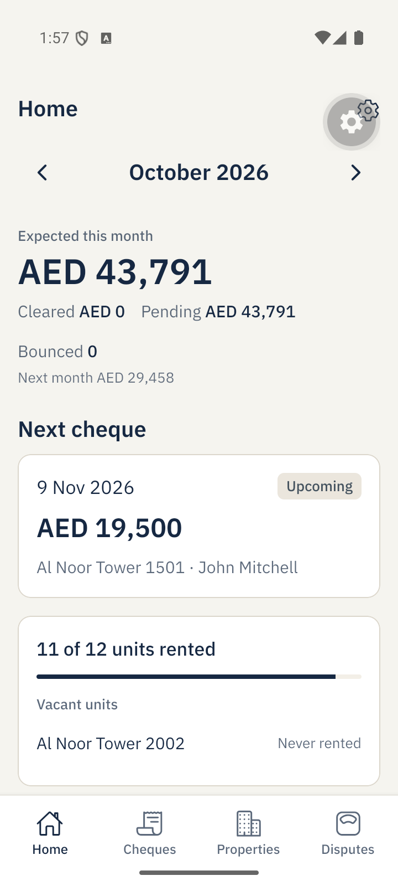
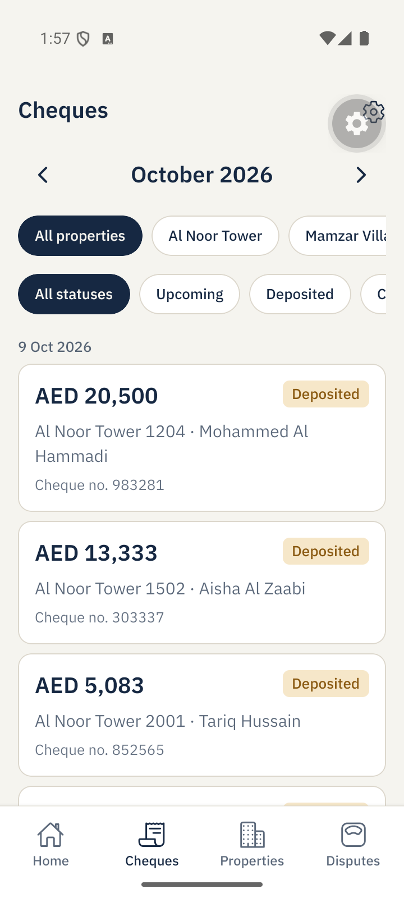
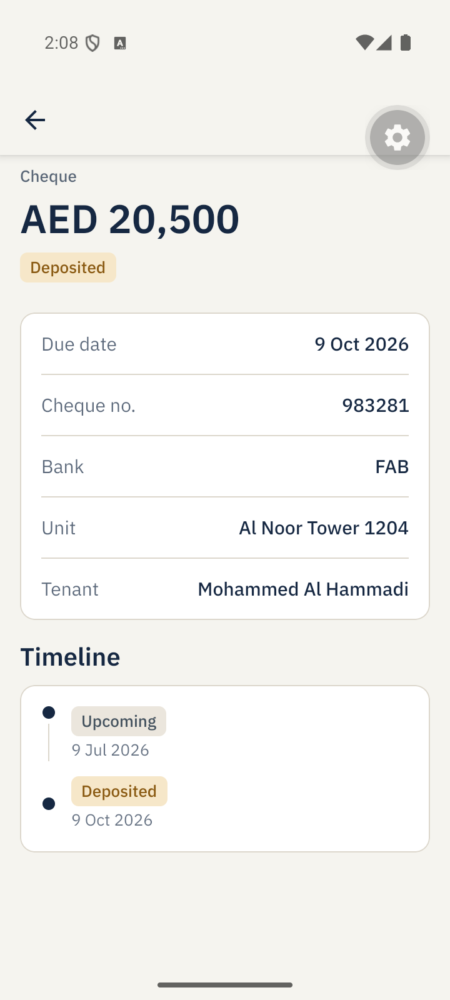
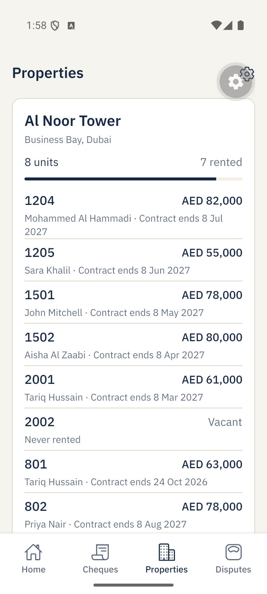
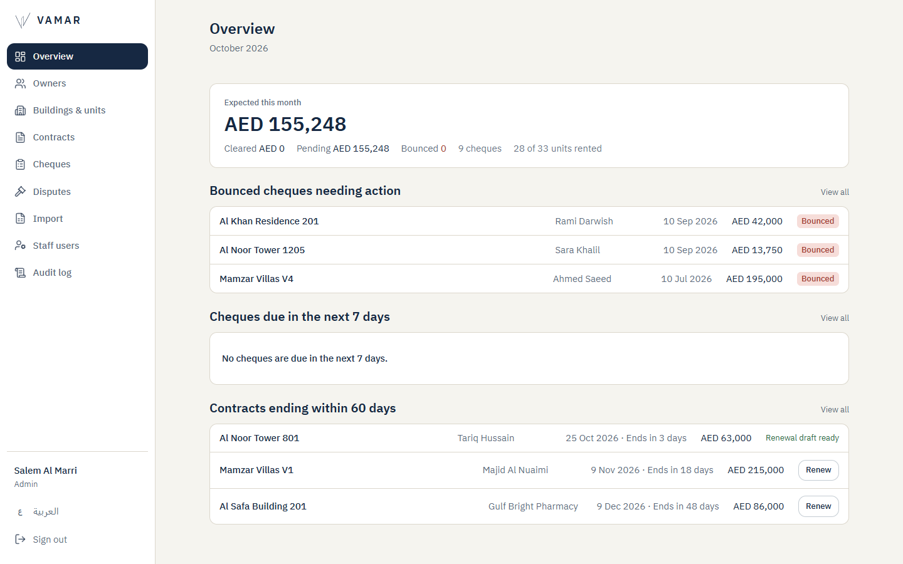
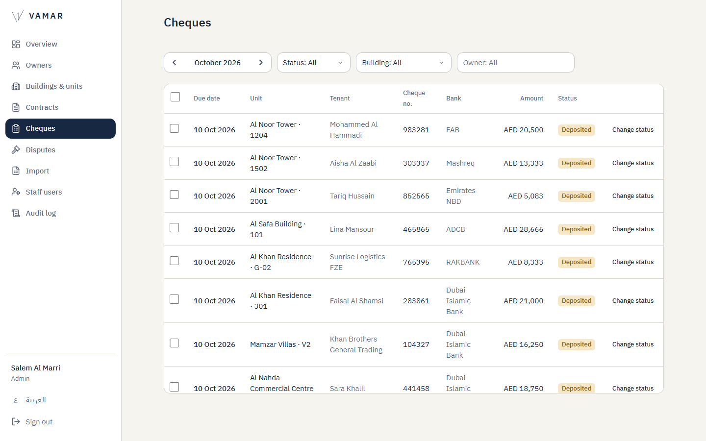
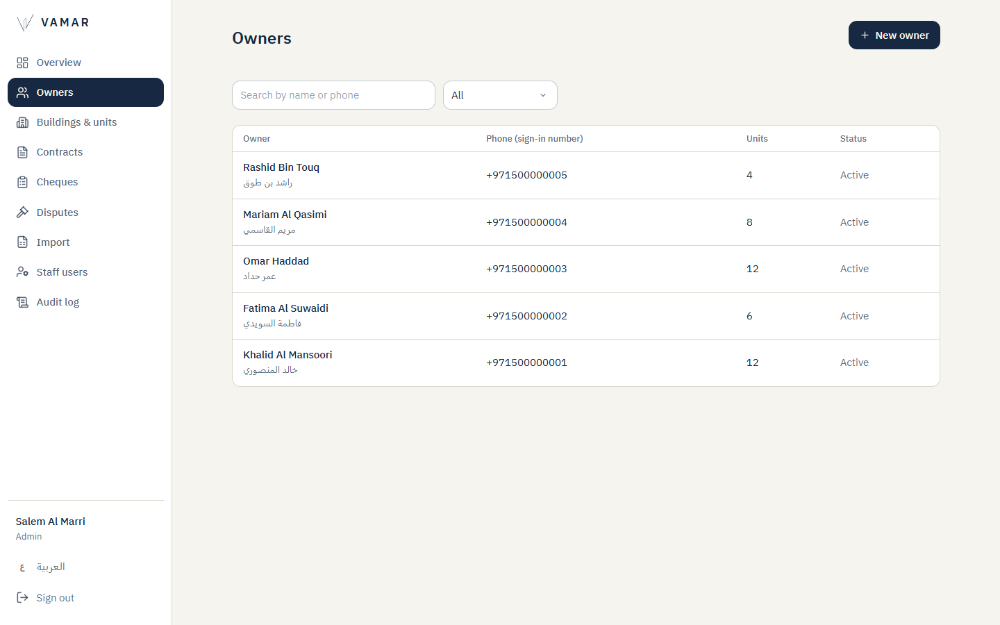

# Vamar Owner Platform

Owner mobile app, staff dashboard and API for **Vamar Real Estate** (Dubai). Property owners follow their rent cheques, units, disputes and statements from their phone, while Vamar's team manages owners, buildings, contracts and cheques from a secure dashboard.

## Try the live demo

All demo data is fictional.

| | Link | Sign in with |
| --- | --- | --- |
| **Owner app (Android)** | [Download the APK](https://vamar-owner-portal.vamar-api.workers.dev/download/vamar-owner-app.apk) | Phone `+971 50 000 0001`, code `123456` (Arabic) or `+971 50 000 0003`, code `123456` (English) |
| **Staff dashboard** | [vamar-owner-portal.vamar-api.workers.dev](https://vamar-owner-portal.vamar-api.workers.dev) | `admin@vamar.test` / `Vamar2026!` (admin) or `entry@vamar.test` / `Vamar2026!` (data entry) |

On iPhone, the screenshots below show the owner app.

## Screenshots

**Owner app**

<p>
  
  
  
  
</p>

**Staff dashboard**

<p>
  
</p>
<p>
  
  
</p>

## What it does

- **Owner app:** phone and OTP sign-in, monthly cheque overview, cheque statuses (upcoming, cleared, bounced), properties and units, shared ownership, disputes, PDF statements, Arabic and English, light and dark themes.
- **Staff dashboard:** owners, buildings, units, contracts, cheques, disputes, Excel import, staff users with roles, two-step login (TOTP) and a full audit log.
- **Security:** every owner only ever sees their own data, staff actions are role-checked on the server, and every change is recorded in the audit log.

## Stack

| Part | Technology |
| --- | --- |
| Owner app | Expo (React Native), TypeScript |
| Staff dashboard | React, Vite, TanStack |
| API | Hono on Cloudflare Workers |
| Database | Neon PostgreSQL with Drizzle ORM |
| Auth | Firebase phone OTP for owners, email + TOTP for staff |
| Files | Cloudflare R2 |
| Monorepo | pnpm workspaces and Turborepo, GitHub Actions CI |

## Run it locally

```
pnpm install
pnpm infra:up && pnpm db:migrate && pnpm db:seed
pnpm check
```

See [PROJECT.md](PROJECT.md) for engineering notes, local setup, decisions and the phase log, and [DEMO.md](DEMO.md) for the full demo script.

---

Built by **Mohammed Ghally**, Dubai · mohammedghallydev@gmail.com
