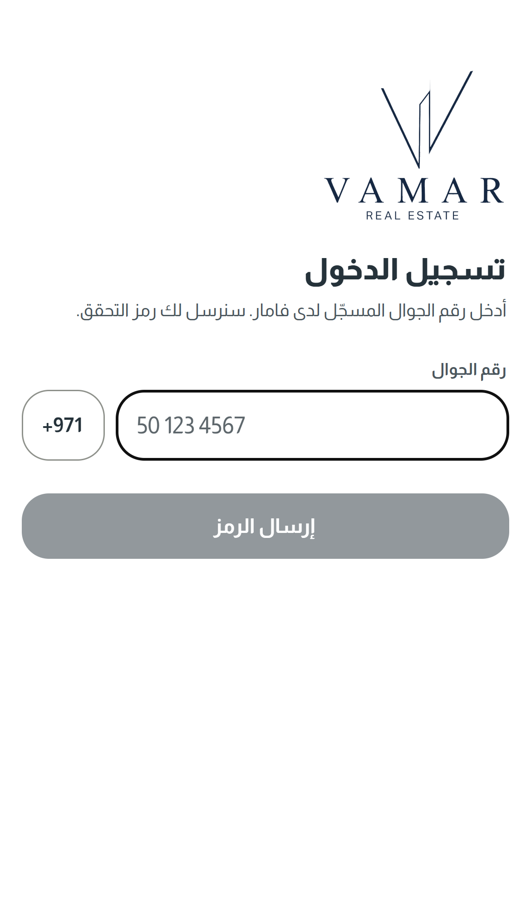
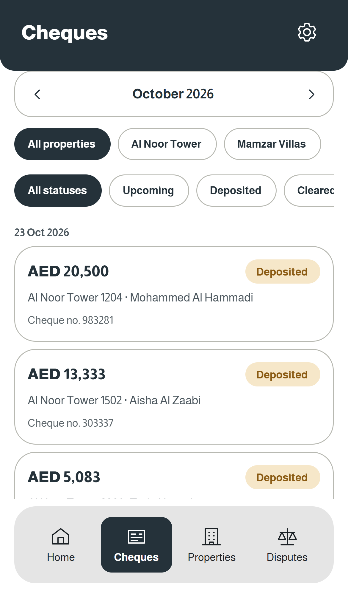
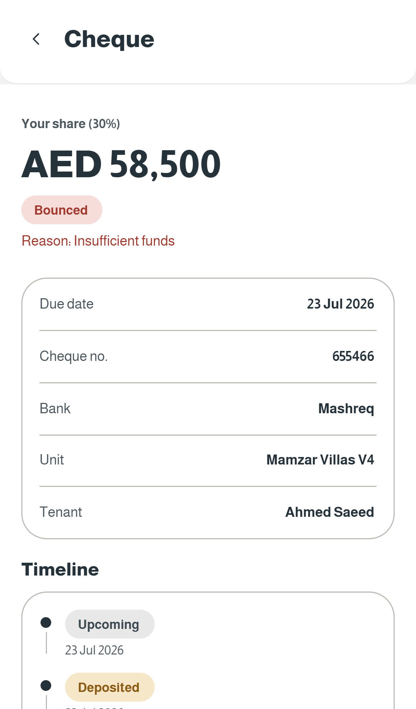
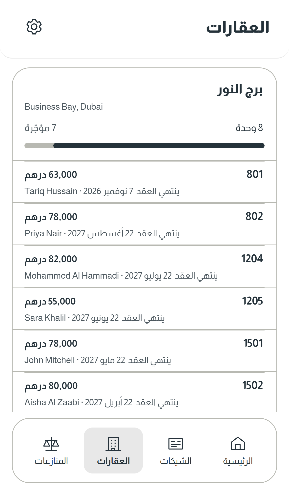
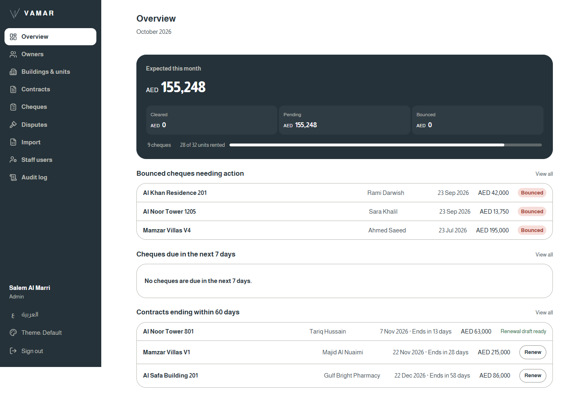
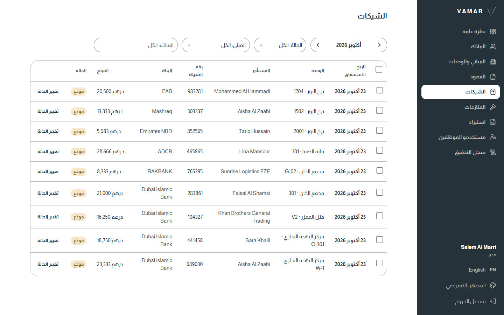
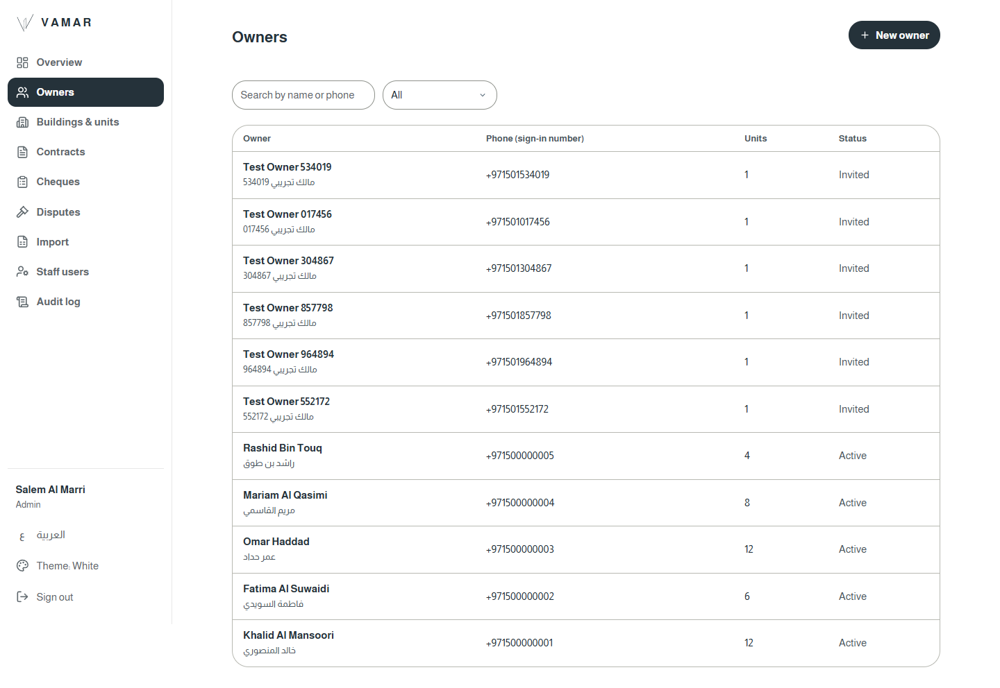

# Vamar Owner Platform

Owner mobile app, staff dashboard and API for **Vamar Real Estate** (Dubai). Property owners follow their rent cheques, units, disputes and statements from their phone, while Vamar's team manages owners, buildings, contracts and cheques from a secure dashboard.

## Try the live demo

All demo data is fictional.

|                     | Link                                                                                                                                               | Sign in with                                                                                    |
| ------------------- | -------------------------------------------------------------------------------------------------------------------------------------------------- | ----------------------------------------------------------------------------------------------- |
| **Owner app**       | [vamar-owner-portal.vamar-api.workers.dev/download](https://vamar-owner-portal.vamar-api.workers.dev/download) (APK on Android, web app on iPhone) | Phone `+971 50 000 0001`, code `123456` (Arabic) or `+971 50 000 0003`, code `123456` (English) |
| **Staff dashboard** | [vamar-owner-portal.vamar-api.workers.dev](https://vamar-owner-portal.vamar-api.workers.dev)                                                       | Demo logins: ask Mohammed                                                                       |

The download page picks the right option for the phone that opens it: the Android app, or on iPhone the same app as a web app at `/app` (Safari, Share, Add to Home Screen). Its QR code is `demo/download-qr.png`. Phone sign-in on the web app starts working once the site is added to Firebase's authorised domains ([BLOCKED.md](BLOCKED.md) item 2).

## Screenshots

The images below show the first release; the v2 screens (expenses, calendar, reports, unit records)
will be added under `demo/screenshots/v3` when that set is generated.

**Owner app**

<p>
  
  
  
  
</p>

**Staff dashboard**

<p>
  
</p>
<p>
  
  
</p>

## What it does

- **Owner app:** phone and OTP sign-in; Home for any period (this month, next month, the next six
  months, this year, last year or any range) with expected rent, collected, outstanding, at risk,
  fixed and variable expenses and net, and a 12-month chart; an Expenses tab with the reason, the
  invoice value and the invoice itself; a calendar (year, month, week, agenda) of cheques due,
  contract ends, hearings, maintenance and holidays; units with their status, property numbers
  (title deed, plot, Makani, DEWA/SEWA) and history; maintenance jobs with photos; disputes with case
  and cheque numbers; PDF statements for any period; Arabic and English, Default and White themes.
- **Staff dashboard:** one period bar for Overview, Cheques, Expenses and Reports with comparison to
  the previous period; owners, buildings, units with status and identifiers, contracts, cheques,
  disputes linked to their bounced cheques; expenses (fixed and variable, VAT, invoice upload, the
  owners' shares split by area, per unit or per owner, recurring fixed costs); work orders as a list
  and a board; a calendar; reports with Excel and PDF export; Ctrl+K search; Excel import of eight
  sheets with a ready template; staff users with roles, two-step login (TOTP) and a full audit log.
- **Security:** every owner only ever sees their own data, staff actions are role-checked on the server, and every change is recorded in the audit log.

## Stack

| Part            | Technology                                            |
| --------------- | ----------------------------------------------------- |
| Owner app       | Expo (React Native), TypeScript                       |
| Staff dashboard | React, Vite, TanStack                                 |
| API             | Hono on Cloudflare Workers                            |
| Database        | Neon PostgreSQL with Drizzle ORM                      |
| Auth            | Firebase phone OTP for owners, email + TOTP for staff |
| Files           | Cloudflare R2                                         |
| Monorepo        | pnpm workspaces and Turborepo, GitHub Actions CI      |

## Run it locally

```
pnpm install
pnpm infra:up && pnpm db:migrate && pnpm db:seed
pnpm check
```

Or the whole stack in containers: `docker compose up -d --build`, then http://localhost:8787.

See [HANDOVER.md](HANDOVER.md) for where everything runs and how a change reaches people, [PROJECT.md](PROJECT.md) for engineering notes and decisions, [GOLIVE.md](GOLIVE.md) for moving to real data, [AUDIT.md](AUDIT.md) for the audit and the scores after it, and [DEMO.md](DEMO.md) for the full demo script.

---

Built by **Mohammed Ghally**, Dubai · mohammedghallydev@gmail.com
