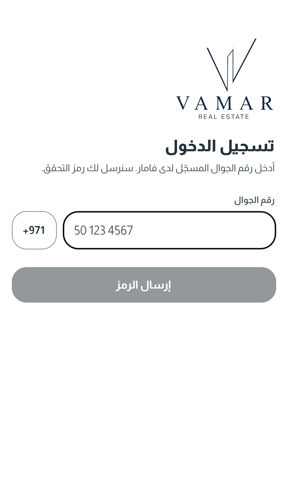
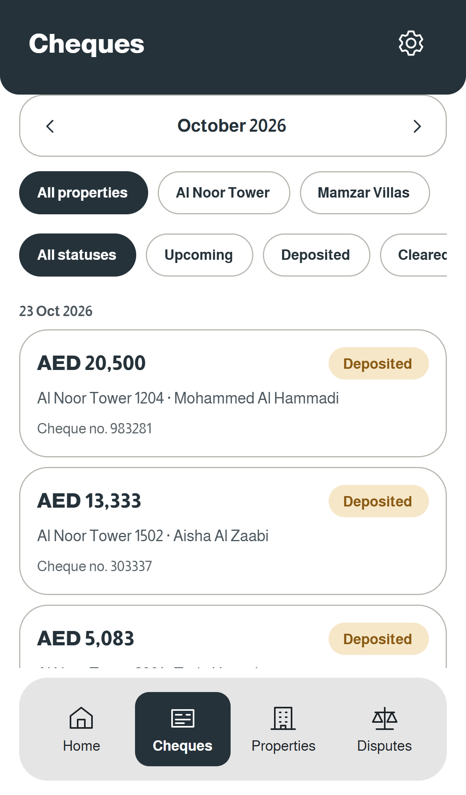
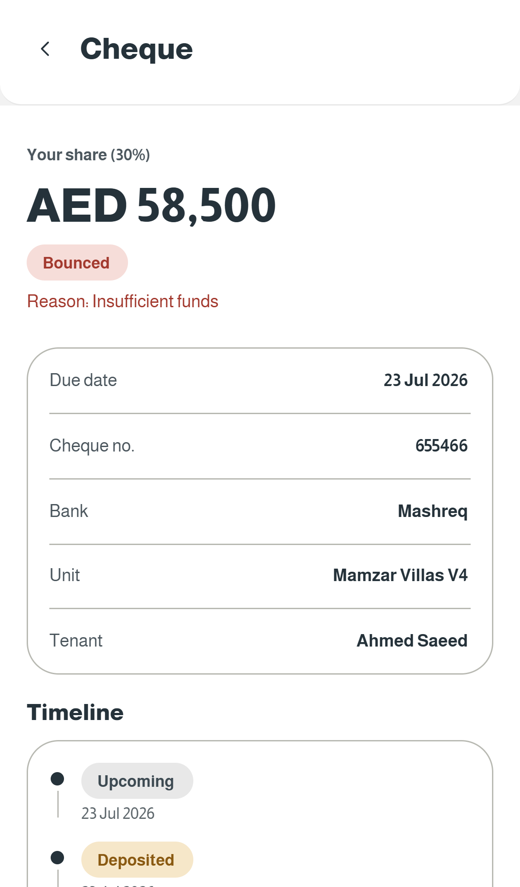
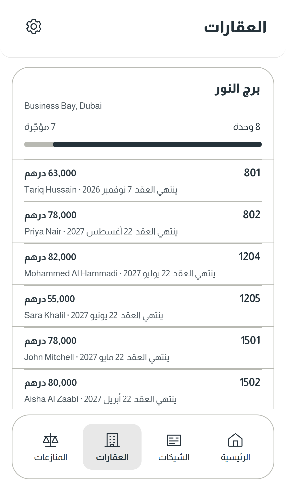
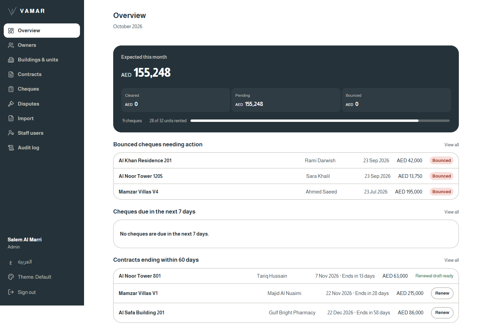
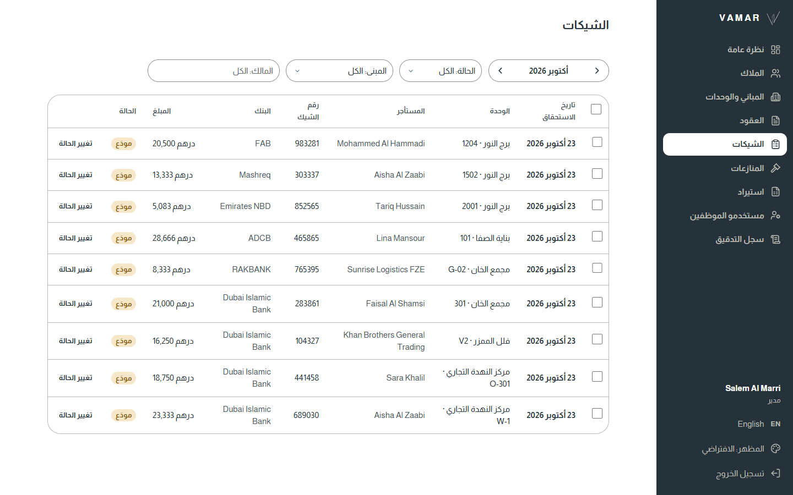
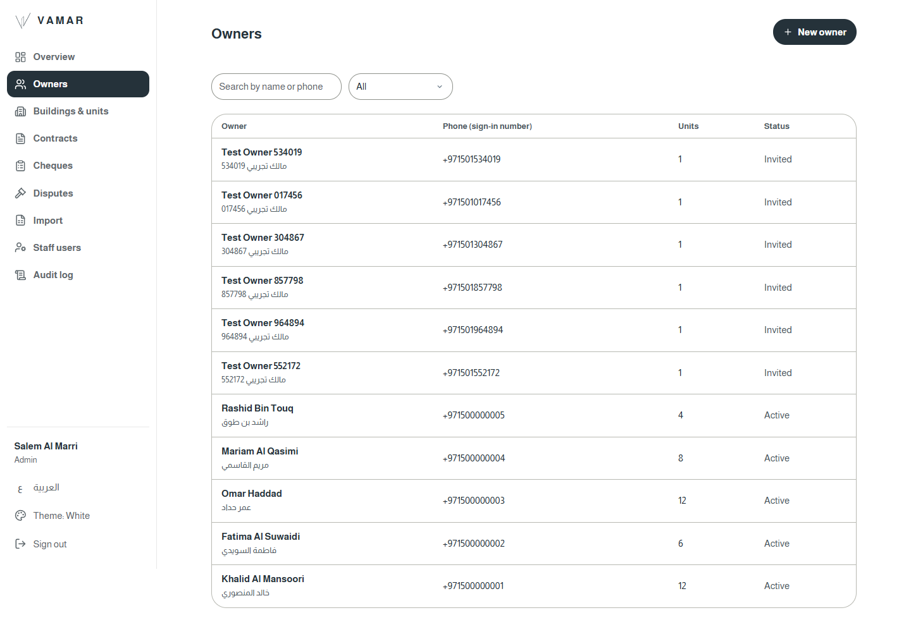

# Vamar Owner Platform

Owner mobile app, staff dashboard and API for **Vamar Real Estate** (Dubai). Property owners follow their rent cheques, units, disputes and statements from their phone, while Vamar's team manages owners, buildings, contracts and cheques from a secure dashboard.

## Try the live demo

All demo data is fictional.

|                     | Link                                                                                                                                               | Sign in with                                                                                    |
| ------------------- | -------------------------------------------------------------------------------------------------------------------------------------------------- | ----------------------------------------------------------------------------------------------- |
| **Owner app**       | [vamar-owner-portal.vamar-api.workers.dev/download](https://vamar-owner-portal.vamar-api.workers.dev/download) (APK on Android, web app on iPhone) | Phone `+971 50 000 0001`, code `123456` (Arabic) or `+971 50 000 0003`, code `123456` (English) |
| **Staff dashboard** | [vamar-owner-portal.vamar-api.workers.dev](https://vamar-owner-portal.vamar-api.workers.dev)                                                       | Demo logins: ask Mohammed                                                                       |

The download page picks the right option for the phone that opens it: the Android app, or on iPhone the same app as a web app at `/app` (Safari, Share, Add to Home Screen). Its QR code is `demo/download-qr.png`. Phone sign-in on the web app starts working once the site is added to Firebase's authorised domains ([BLOCKED.md](BLOCKED.md) item 2).

## Screenshots

**Owner app**

<p>
  
  
  
  
</p>

**Staff dashboard**

<p>
  
</p>
<p>
  
  
</p>

## What it does

- **Owner app:** phone and OTP sign-in, monthly cheque overview, cheque statuses (upcoming, cleared, bounced), properties and units, shared ownership, disputes, PDF statements, update check, Arabic and English, Default and White themes.
- **Staff dashboard:** owners, buildings, units, contracts, cheques, disputes, Excel import (owners, buildings, units, tenants, ownership shares, contracts and cheques) with a ready template, staff users with roles, two-step login (TOTP) and a full audit log.
- **Security:** every owner only ever sees their own data, staff actions are role-checked on the server, and every change is recorded in the audit log.

## Stack

| Part            | Technology                                            |
| --------------- | ----------------------------------------------------- |
| Owner app       | Expo (React Native), TypeScript                       |
| Staff dashboard | React, Vite, TanStack                                 |
| API             | Hono on Cloudflare Workers                            |
| Database        | Neon PostgreSQL with Drizzle ORM                      |
| Auth            | Firebase phone OTP for owners, email + TOTP for staff |
| Files           | Cloudflare R2                                         |
| Monorepo        | pnpm workspaces and Turborepo, GitHub Actions CI      |

## Run it locally

```
pnpm install
pnpm infra:up && pnpm db:migrate && pnpm db:seed
pnpm check
```

Or the whole stack in containers: `docker compose up -d --build`, then http://localhost:8787.

See [HANDOVER.md](HANDOVER.md) for where everything runs and how a change reaches people, [PROJECT.md](PROJECT.md) for engineering notes and decisions, [GOLIVE.md](GOLIVE.md) for moving to real data, [AUDIT.md](AUDIT.md) for the audit and the scores after it, and [DEMO.md](DEMO.md) for the full demo script.

---

Built by **Mohammed Ghally**, Dubai · mohammedghallydev@gmail.com
